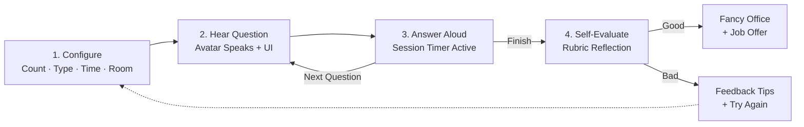

# Wellthy — 10-Minute PowerPoint Deck & Script (`CSI 4104`)

**Team:** Neetcode — Isabelle Choi & Ben Gilbert  
**Aligned with:** `project_reqs/project_outline.txt` & `project_reqs/project_proposal.txt`  
**Total Time Budget:** ~6:35 speaking + ~2:15 demo = **8:50** (+ **1:10–1:30** Q&A = **10:00 total**)

---

## Slide 1: Title & Overview (`0:00 – 0:40` | Speaker: Isabelle)

**Slide Bullets:**
- **Wellthy** — VR Interview Practice Simulator
- **Team Neetcode:** Isabelle Choi & Ben Gilbert (`CSI 4104`)
- **XR Type:** Virtual Reality (VR)
- **Target Audience:** Undergraduate CS/Tech co-op students & recent graduates

**Script:**
> "Hi everyone, we're Team Neetcode—I'm Isabelle and this is Ben—and our project is **Wellthy**, a Virtual Reality interview practice simulator built for undergraduate co-op students and recent tech graduates.
>
> Wellthy is a pure **VR** experience. We chose VR over AR or mixed reality because we don't want the user's real bedroom or study space breaking their focus—VR lets us take full control of the room, the lighting, and the virtual interviewer so the user feels like they're actually sitting in an interview."

---

## Slide 2: What the User Does & Why VR (vs. a Web App) (`0:40 – 1:55` | Speaker: Isabelle)

**Slide Bullets:**
- **Configure Session:** Question count · Behavioral vs. Technical · Duration (`5 / 15 / 30 min`) · Room backdrop
- **Interactive Loop:** View & hear question read aloud → Begin question → Answer under timer → Next / Finish
- **Reflect & Outcome:** Interpret rubric + Self-evaluation → **"Good"** (Fancy Office + Job Offer) or **"Bad"** (Tips + Try Again)
- **Why VR Instead of a Web Browser?**
  - **Blocks real-world distractions:** Headset isolates the user inside an office, creating real situational stakes
  - **Life-sized social presence:** Facing a human-scale interviewer trains eye contact, posture, and conversation dynamics
  - **Contextual muscle memory:** Safe, repeatable exposure desensitizes the "freeze" response under timer pressure

**Slide Visual (Export via [mermaid.live](https://mermaid.live) as SVG/PNG):**

**Script:**
> "Here is how a session works. Before starting, the user configures their interview: how many questions they want, whether they want **behavioral or technical** questions, how long the session should last—**5, 15, or 30 minutes**—and the **room backdrop**.
>
> During the interview, a question appears on screen and is **spoken aloud by the virtual interviewer**. The user clicks to begin, answers out loud while the session timer runs, and moves to the next question or finishes early. Afterward, they complete a **rubric-guided self-evaluation** and reflect on whether it went **good**—moving them into a **fancy office with a job offer**—or **bad**, showing **feedback tips** to try again.
>
> Now, why build this in **VR** instead of a normal web browser app? On a laptop, you're still sitting in your bedroom—it's easy to glance at notes in another tab, ignore notifications, and feel zero real stakes. In VR, putting on the headset **cuts off your real-world safety net** and puts you across a desk from a **life-sized interviewer** making eye contact with you. That forces you to practice real conversation dynamics—pacing, posture, and thinking on your feet—while building **contextual muscle memory**. Because it's repeatable and private, you can fail safely until the interview nerves fade."

---

## Slide 3: Social Good — Simulation (`1:55 – 2:30` | Speaker: Ben)

**Slide Bullets:**
- **Social Good Area:** Simulation (Public Speaking & Interview Readiness)
- **The Problem:** Early-career students often freeze under real interview pressure
- **How Wellthy Helps:**
  - Replaces passive flashcard reading with embodied social pressure
  - Desensitizes anxiety through realistic repetition
  - Builds confidence before real co-op interviews

**Script:**
> "Our target social good area is **simulation**—specifically helping early-in-career students overcome public speaking and interview anxiety.
>
> Practicing alone with flashcards or reading questions off a screen doesn't prepare you for the emotional stress of an employer staring at you while a clock ticks down. Wellthy simulates the physical environment, intellectual engagement, and social pressure of a real interview. Our goal is that after a few runs in VR, students walk into their real co-op interviews feeling calmer, more prepared, and more confident."

---

## Slide 4: Live / Video Demo (`2:30 – 4:45` | Speaker: Ben & Isabelle)

**Slide Bullets:**
- **Wellthy Demo Walkthrough**
  1. Configure session (`5 min`, Behavioral, Room Backdrop)
  2. Interviewer reads question aloud + lip-sync
  3. Answer & advance through questions
  4. Rubric self-evaluation
  5. Good / Bad outcomes (*Fancy Office + Job Offer* vs. *Feedback Tips*)

**Narrated Demo Script:**
> "Now let's show you Wellthy in action.
>
> *(0:00–0:25)* Here we start at the setup panel—we'll pick a **5-minute behavioral** interview, choose our question count, and select our **room background** to customize the environment.
>
> *(0:25–1:05)* Once we start, the interviewer greets us and **reads the first question aloud** using natural synthesized speech synced with mouth movement, while the prompt appears on our desk UI. We click **Begin Question**, answer out loud with the timer running, and click **Next Question** or **Finish Session** when done.
>
> *(1:05–1:45)* At the end, we review the **rubric**—checking things like structure and clarity—and complete our **self-evaluation**. Finally, we get the reflection prompt. Selecting **Good** transitions us into our **new fancy office with a job offer**—and if a user feels it went **Bad**, they instead get targeted **feedback tips** and a prompt to try again."

*(Backup tip: Embed a pre-recorded 1080p MP4 video directly onto this slide in case live VR headset casting glitches.)*

---

## Slide 5: Project Implementation — XR Illusions (`4:45 – 6:20` | Speaker: Isabelle)

**Slide Table:**

| Wellthy VR Aspect | Implementation | Benefit of the Aspect |
| --- | --- | --- |
| **Place Illusion** *(Yes — Integrated)* | Enclosed 3D interview room + desk & office props; life-sized virtual interviewer(s); customizable room backgrounds + 3D spatial audio | Blocks out the user's familiar room (unlike AR or a browser), convincing them they are at an employer's office and evoking real stakes |
| **Plausibility Illusion** *(Yes — Integrated)* | Real CS/Tech interview questions from a curated bank; natural spoken audio + lip-sync; session countdown timer | Makes the interaction feel genuinely real and time-pressured, training verbal composure and muscle memory rather than passive recall |
| **Body Embodiment Illusion** *(Not Prioritized)* | Basic controller rays for UI only; full-body tracking omitted since no physical object manipulation is needed | Keeps focus on verbal and intellectual engagement—believing you are in the room participating achieves our goal without extra complexity |

**Script:**
> "Looking at how XR illusions were implemented in Wellthy:
>
> First, **Place Illusion** is critical for our project. We implemented it by placing the user in an enclosed 3D interview room with a virtual interviewer sitting across from them, 3D spatial audio, and **customizable room backgrounds** so the setting feels like a real company office.
>
> Second, **Plausibility Illusion** is equally important—users need to feel like the interview events are plausibly real. We achieved this by pulling **real tech company interview questions**, having the interviewer speak them aloud with lip-sync and animations, and maintaining realistic interview pacing with a countdown timer.
>
> Third, **Body Embodiment Illusion** was intentionally not a priority. Because Wellthy focuses on verbal communication and intellectual problem-solving rather than manipulating physical objects, full-body tracking isn't needed—as long as the user believes they are present in the interview room and actively participating, we achieve our design goals."

---

## Slide 6: Educational Methods, Game Loop & SDT (`6:20 – 8:10` | Speaker: Ben)

**Slide Bullets:**
- **Educational Method (Week 4): Experiential Learning**
  - Learning in context by doing, failing safely, retrying, and self-reflecting via a rubric
- **Storytelling vs. Simulation / Game Loop:**
  - Randomized simulation (not linear storytelling)
  - Lightweight win/retry loop: **Good** (Fancy Office + Job Offer) vs. **Bad** (Feedback Tips + Retry)
- **Self-Determination Theory (SDT) — Yes:**
  - **Autonomy:** Choose question count, type, duration, backdrop, and self-evaluate
  - **Competence:** Rubric guidance + visible growth toward the job offer
  - **Relatedness:** Conversational dynamic with a human-like interviewer

**Script:**
> "For our pedagogical design, Wellthy uses **Experiential Learning** from Week 4. Rather than passively studying interview tips, students practice applying their knowledge in context—trying, occasionally stumbling, using the **rubric** to reflect on what went wrong, and immediately retrying.
>
> Wellthy is designed as a randomized simulation rather than linear storytelling, since the questions change every run. However, we included a lightweight **win-and-retry loop** at the end: if users feel they succeeded, they're rewarded with their new **fancy office and a job offer**; if not, they get **actionable tips** to encourage another attempt.
>
> Finally, we incorporated all three pillars of **Self-Determination Theory**:
> - **Autonomy**, by letting users customize their question count, type, duration, and room;
> - **Competence**, by guiding improvement with a structured rubric and rewarding mastery; and
> - **Relatedness**, by simulating a real human-to-human conversation with our virtual interviewer."

---

## Slide 7: Wrap-Up & Questions (`8:10 – 10:00` | Speaker: Both)

**Slide Bullets:**
- **Summary:** Safe, repeatable VR interview simulator for CS/Tech co-op prep
- **Future Work:** Live speech-to-text transcription & AI feedback on user answers
- **Questions?** — Thank you!

**Script:**
> "To wrap up, Wellthy gives CS and tech students a safe, repeatable way to build interview confidence through VR immersion, real spoken questions, and rubric-guided self-reflection. In the future, we'd love to add speech-to-text analysis for automated answer feedback.
>
> Thank you—we'd love to take any questions!"

---

## Quick Pre-Presentation Checklist

- [ ] Fill in Section I.c and the `[...]` placeholders in `project_reqs/project_outline.txt` (if turning in the outline doc).
- [ ] Export the Slide 2 Mermaid diagram from [mermaid.live](https://mermaid.live) as SVG/PNG.
- [ ] Embed a backup 1080p demo recording in Slide 4.
- [ ] Rehearse the full presentation once with a timer (~8:30 before Q&A).
