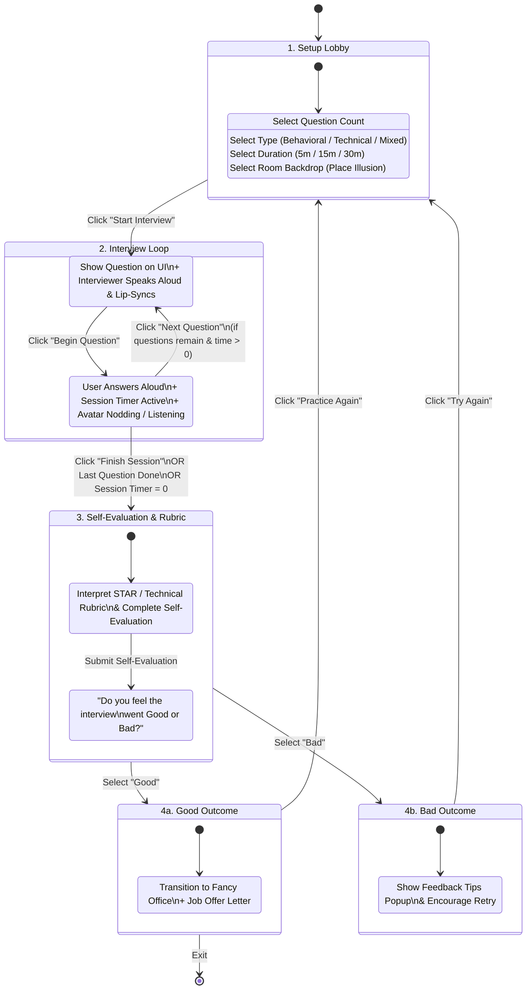

# Wellthy — Project & Presentation Roadmap (`CSI 4104`)

**Team:** Neetcode — Isabelle Choi & Ben Gilbert  
**Deliverables:**
1. Completed Unity VR Application (**Wellthy**)
2. 10-Minute PowerPoint Presentation (aligned with `project_reqs/project_outline.txt`)

---

## 1. Tech Stack & Unity Setup

| Layer | Recommended Choice | Notes |
| --- | --- | --- |
| **Engine** | Unity 6 LTS or Unity 2022.3 LTS | Pick one exact version and commit `ProjectSettings/` + `Packages/` so both teammates stay synced. |
| **VR SDK** | **Meta XR All-in-One SDK** (or **Unity XR Interaction Toolkit**) | Use Meta XR SDK if targeting Quest 2/3 directly (includes Building Blocks & LipSync). Use XRIT if testing across PCVR / Quest Link. |
| **Version Control** | Git + Git LFS (or Unity Version Control) | **Crucial:** Use the Unity `.gitignore`, track `.fbx`/`.wav`/`.png` with LFS, and separate scenes/prefabs so you don't get merge conflicts. |
| **Interviewer Avatar** | **Ready Player Me** or **Mixamo** humanoid rig | Free, fast, humanoid-rigged, and works immediately with Unity `Animator` + lip-sync packages. |
| **Lip-Sync** | **uLipSync** (open-source) or **Oculus LipSync** | Drives avatar mouth blendshapes directly from the `AudioSource` playing the interviewer's voice. |

---

## 2. Interviewer Voice (TTS): Best APIs & Recommended Architecture

Your interviewer needs to read behavioral and technical questions aloud clearly and naturally to support **Plausibility Illusion**.

### API Comparison

| Option | Voice Quality | Latency | Cost / Limits | Unity Integration | Verdict |
| --- | --- | --- | --- | --- | --- |
| **ElevenLabs API** (`Flash v2.5` / `v4 Turbo`) | Best-in-class, natural, expressive | ~75–150 ms (streaming) | Free tier (10k chars/mo); Starter ~$5/mo | Easy via `UnityWebRequest` or Meta XR `TextToSpeechAgent` (`ElevenLabsProvider`) | **Best Overall Choice** |
| **Meta Voice SDK (`TTSSpeaker`)** | Good (clear, slightly synthetic) | Low + built-in disk caching | Free tier via Wit.ai | Native Quest package; one-line `speaker.Speak(text)` | **Best Free Quest-Native Option** |
| **Microsoft Azure AI Speech** | Very good + SSML pauses/tone | Low | Free tier (500k chars/mo) | Official C#/.NET SDK or REST; returns **viseme timestamps** for lip-sync | **Best for SSML & Visemes** |
| **Edge-TTS (Python script, offline prep)** | Very good (Microsoft neural voices) | N/A (pre-generated) | Free | Run once locally to export `.mp3`/`.wav` files into Unity | **Best Zero-Cost Pre-Bake** |
| **OpenAI TTS** (`tts-1` / `gpt-4o-mini-tts`) | — | — | — | Standalone TTS models are deprecated in favor of `gpt-realtime-2.1` | **Skip** (overkill unless doing live conversational AI) |

### Recommended Approach: **Pre-Baked Audio Clips + Optional Live API Fallback**

Because Wellthy uses a **curated bank of real tech/CS interview questions** (not open-ended improvised chat), **pre-generating the audio files** with **ElevenLabs** (or **Edge-TTS**) and bundling them as Unity `AudioClip` assets is the safest and highest-quality engineering choice:

1. **Zero live-demo risk:** Works offline during your in-class presentation (no campus Wi-Fi drops, no rate limits, no exposed API keys in the build).
2. **Zero latency:** The interviewer begins speaking the instant the question starts.
3. **Trivial lip-sync:** Playing a standard `AudioClip` through a Unity `AudioSource` feeds directly into **uLipSync** or **Oculus LipSync** with zero extra networking code.
4. **Future-proof interface:** Wrap playback behind an `IInterviewerVoice` interface (`PlayQuestion(QuestionData q)`). If you want dynamic/personalized greetings later, you can swap in `ElevenLabsProvider` or `TTSSpeaker` for just the intro/outro lines.

#### Recommended Workflow for Pre-Baking Questions
1. Finalize 20–30 Behavioral + 20–30 Technical questions in a `questions.json` file.
2. Run a small Python script calling the **ElevenLabs API** (using a professional, calm interviewer voice) to generate `Assets/Audio/Questions/<id>.mp3` for every question + a few intro/outro clips (*"Welcome to your interview..."*, *"Great, let's move to the next question."*).
3. Load each `AudioClip` into a `QuestionData` `ScriptableObject` (or address it by `id` from `Resources/Audio/Questions/`).

---

## 3. Core Unity Architecture & Required Features

Every feature below maps directly to `project_reqs/project_outline.txt`.

### A. User Flow & State Machine (`InterviewSessionManager`)

### B. Key Systems to Build

1. **Question & Rubric Data (`QuestionData.cs` + `questions.json`)**
   - Fields: `id`, `type` (`Behavioral` / `Technical`), `promptText`, `audioClipPath`, `rubricHints` (3–4 bullet points specific to that question, e.g., *Situation, Task, Action, Result* or *Time/Space Complexity*).
2. **Configuration & Session Manager (`InterviewConfig.cs`, `InterviewSessionManager.cs`)**
   - Stores selected count, type, duration (`300s`, `900s`, `1800s`), and room theme.
   - Randomly samples non-repeating questions matching the chosen type.
   - Tracks elapsed session time and per-question completion.
3. **Environment & Backdrop Switcher (`EnvironmentManager.cs`)**
   - Supports **Place Illusion** via 3 switchable interview settings (e.g., *Modern Tech Startup Office*, *Corporate Glass Boardroom*, *Minimalist Quiet Studio*) — implemented by toggling lighting presets, skyboxes, and background prop groups around the same central desk so the UI & interviewer don't need repositioning.
   - Includes a dedicated **Fancy Office + Job Offer** state/scene for the *"Good"* ending.
4. **Interviewer Avatar Controller (`InterviewerController.cs`)**
   - Plays `AudioClip` on `AudioSource` positioned at the avatar's head (3D spatial audio).
   - Triggers `Animator` states (`Idle_Seated`, `Talking`, `Nodding_Listening`) and eye-tracking (`LookAt` user's VR camera rig with subtle natural clamping).
   - Drives mouth movement via **uLipSync** / **Oculus LipSync**.
5. **VR Ergonomic UI (World-Space Canvases)**
   - Keep text large, high-contrast, and ~1.5–2m away on a curved World-Space Canvas or sleek tablet/monitor on the desk so users never strain their neck.
   - Include a "Show/Hide Question Text" toggle so users can rely purely on listening (harder/more realistic) or read along.
6. **Self-Evaluation & Endings (`EvaluationManager.cs`)**
   - Displays the structured rubric (e.g., *Communication Clarity*, *Structure / STAR*, *Confidence & Pacing*, *Technical Accuracy*).
   - Final Good/Bad prompt:
     - **Good:** Transitions lighting/room to the **New Fancy Office**, spawns a celebratory **Job Offer** prop/panel on the desk, and plays subtle celebration audio.
     - **Bad:** Displays a supportive popup with actionable interview tips (based on the rubric items they scored lowest on) and a **Try Again** button that resets the session.

---

## 4. Two-Person Division of Work & Execution Timeline

Assuming ~2.5–3 weeks until final submission/presentation (targeting completion by **early December 2026**):

### Role Split (Minimize Scene Merge Conflicts)

- **Teammate A — VR World, Avatar & Audio/TTS (`Environment`, `Avatar`, `Demo`)**
  - Unity XR rig setup (Meta Quest / XRIT), locomotion/seated calibration, raycast UI interaction.
  - Interview room modeling/asset assembly + 3 customizable room backgrounds + the **Fancy Office + Job Offer** ending scene.
  - Interviewer 3D avatar setup (Mixamo animations: idle, talking, nodding) + **uLipSync / Oculus LipSync**.
  - Curating the question bank (`questions.json`) + running the ElevenLabs/Edge-TTS generation script for all audio clips.
- **Teammate B — Game Logic, UI & Evaluation Systems (`Scripts`, `UI`, `State Machine`)**
  - `InterviewConfig` & `InterviewSessionManager` state machine.
  - Setup UI (question count, type, duration: 5/15/30 min, room backdrop selector).
  - Active interview HUD (timer, Begin Question, Next Question, Finish Session).
  - Self-Evaluation Rubric UI + Good/Bad reflection branching logic & feedback tips popup.
  - Sound effects (timer chime, UI clicks, ambient office hum, job offer chime).

*(Work in separate prefabs/sub-scenes — e.g. `UI_Canvas.prefab` vs. `Environment_Root.prefab` — and only merge into `MainInterview.unity` after testing in isolation.)*

### Phase-by-Phase Schedule

#### Phase 1: Foundation & Vertical Slice (Days 1–4)
- [ ] Create shared Unity project + Git repo + agree on exact Unity version & XR SDK.
- [ ] Set up seated VR camera rig with controller pointer working on a World-Space Canvas.
- [ ] Draft 20 Behavioral + 20 Technical CS/Co-op questions in `questions.json` and generate audio clips with ElevenLabs (or Edge-TTS).
- [ ] **Milestone Check:** You can put on the headset, click a button, and hear Question #1 read aloud in VR.

#### Phase 2: Core Interview Loop & Avatar (Days 5–9)
- [ ] Build full Setup screen (Count, Type, Duration: 5/15/30 min, Backdrop selector).
- [ ] Implement `InterviewSessionManager` loop: *Speak Question → Begin Question → Answer Timer → Next / Finish*.
- [ ] Import interviewer avatar, add seated idle/nodding/talking animations, and wire up lip-sync + camera LookAt.
- [ ] **Milestone Check:** A full 5-minute mock interview runs end-to-end with the animated interviewer speaking each question.

#### Phase 3: Place Illusion, Rubric & Endings (Days 10–13)
- [ ] Build 3 distinct room backgrounds (e.g., Startup Office, Corporate Boardroom, Minimalist Studio) + subtle ambient room audio.
- [ ] Build the Self-Evaluation & Rubric UI (interactive checklist/sliders + rubric guide).
- [ ] Implement the final *"Did the interview go Good or Bad?"* question:
  - [ ] **Good:** Transition to Fancy Office + Job Offer.
  - [ ] **Bad:** Feedback tips popup + Try Again loop.
- [ ] **Milestone Check:** Feature-complete build tested on actual VR headset.

#### Phase 4: Polish, Playtest & Presentation Prep (Days 14–17)
- [ ] Run 2–3 end-to-end VR playtests (check text readability, audio volume, timer pacing, no VR motion sickness).
- [ ] Record a clean **1080p screen-capture backup video** of the full demo (critical insurance for live presentations).
- [ ] Build the 10-minute PowerPoint presentation and rehearse timing together.

---

## 5. 10-Minute PowerPoint Presentation Plan (Aligned with `project_outline.txt`)

Target **8.5 minutes** of speaking + demo, leaving **1.5 minutes** for Q&A.

| Slide(s) | Outline Section | Time | Key Content to Cover |
| --- | --- | --- | --- |
| **1–2** | **I. Title & Description** | **1:30** | **Wellthy** (Team Neetcode). **XR Type:** Virtual Reality (VR) — chosen for total control over the room & interviewer without real-world distractions. **Features:** configurable count, behavioral/technical type, 5/15/30-min duration, spoken questions, self-eval rubric, Good/Bad endings. **Social Good:** *Simulation* — easing public speaking & interview anxiety for CS/Tech co-op students and new grads through safe, repeatable muscle-memory practice. |
| **3** | **II. Live / Video Demo** | **2:30** | Show the full loop cleanly (1–2 min): configure a 5-min interview + pick room backdrop → hear the interviewer read a question aloud with lip-sync → complete question → open rubric self-evaluation → show the "Good" Fancy Office ending (and briefly mention/show the "Bad" feedback popup). *Keep a pre-recorded MP4 embedded in the slide as backup.* |
| **4–5** | **III. Project Implementation (Illusions)** | **2:00** | **Place Illusion (Yes):** Implemented via enclosed 3D interview room, seated interviewer avatar in front of the user, spatial audio, and customizable room backgrounds. **Plausibility Illusion (Yes):** Implemented via real CS/tech interview questions spoken aloud with avatar eye contact/lip-sync, session countdown timer, and realistic interview pacing. **Body Embodiment Illusion (No / Minimal):** Not necessary for our goal—the focus is intellectual & verbal engagement rather than physical object manipulation; basic controller rays suffice. |
| **6–7** | **IV. Educational Methods & SDT** | **2:00** | **Week 4 Educational Method:** *Experiential Learning* — learning by doing in context, trying/failing/retrying, and structured self-reflection using a rubric. **Storytelling / Game Elements:** Primarily a randomized simulation rather than a linear story; however, the **Good/Bad ending** provides a lightweight win/retry feedback loop. **Self-Determination Theory (SDT):** *Autonomy* (user configures questions, duration, room, and self-evaluates), *Competence* (rubric guidance, building confidence, earning the "Good" job offer), and *Relatedness* (conversational presence with a human-like interviewer avatar). |
| **8** | **V. Questions & Wrap-Up** | **2:00** | Quick summary of takeaways / future work (e.g., AI speech-to-text answer analysis) + open floor for Q&A (`~1:30–2:00`). |

---

## 6. Quick Pre-Submission Checklist

- [ ] Does `project_outline.txt` Section I.c (*Social good area*) have your final bullet points filled in before submitting slides? (Covered in Slide 1–2 above!)
- [ ] Can the user configure **Question Count**, **Behavioral/Technical**, and **5 / 15 / 30 min** duration?
- [ ] Does the interviewer **read every question aloud** clearly with mouth/idle animation?
- [ ] Can the user **begin**, **advance to next**, or **finish** the session early?
- [ ] Are **Self-Evaluation** and **Rubric Interpretation** both clearly interactive at the end?
- [ ] Does the **Good/Bad** prompt trigger the **Fancy Office + Job Offer** vs. **Try Again + Feedback Tips** popup?
